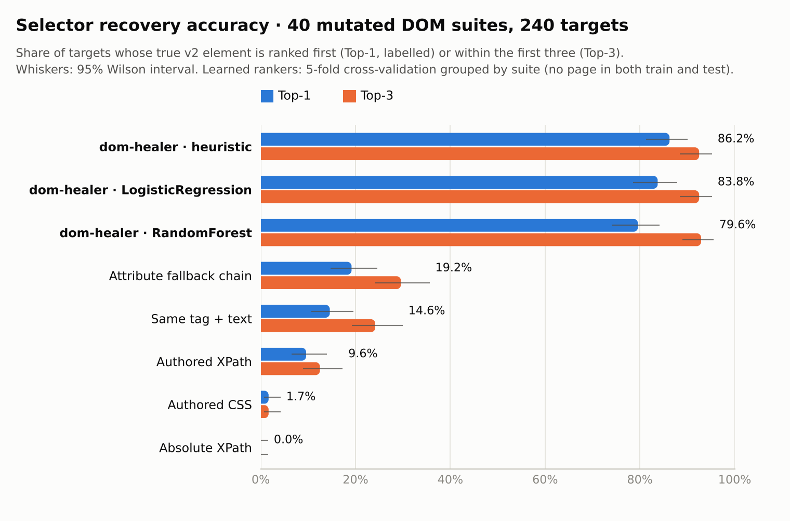
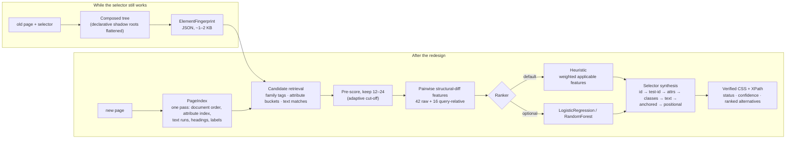
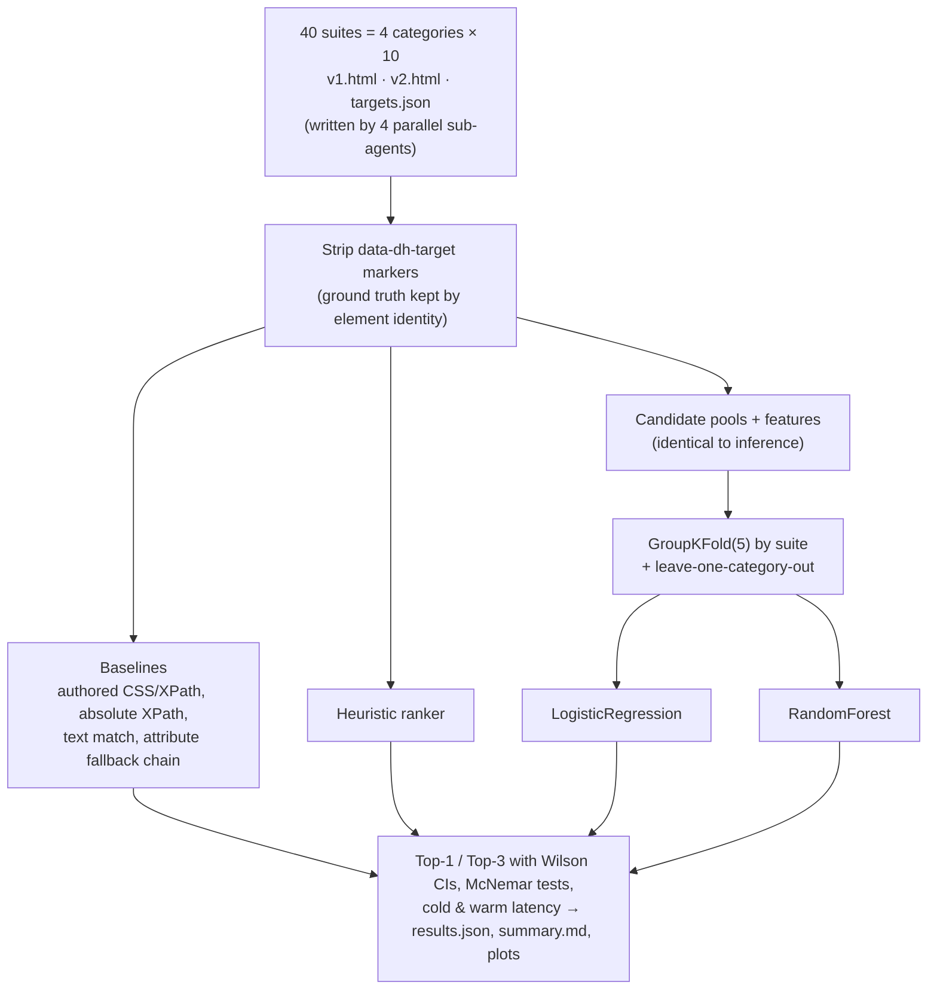
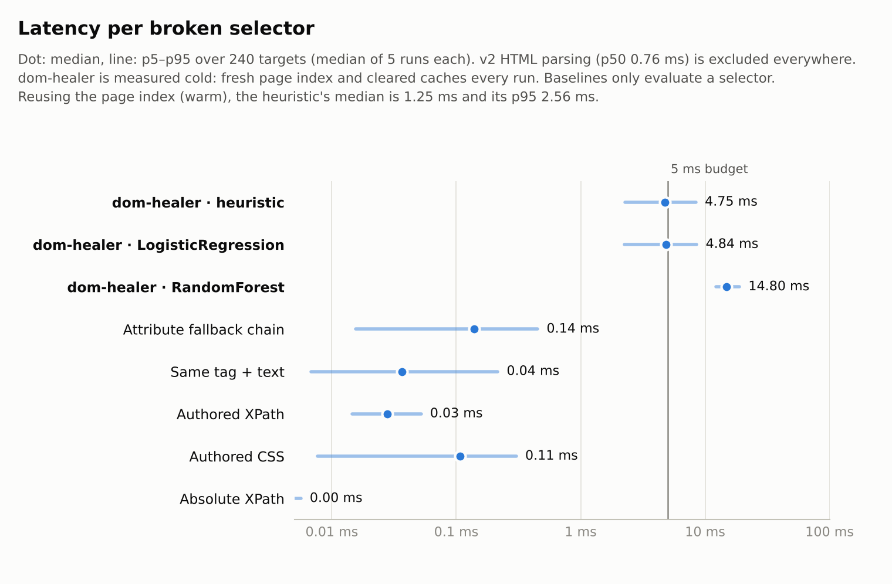
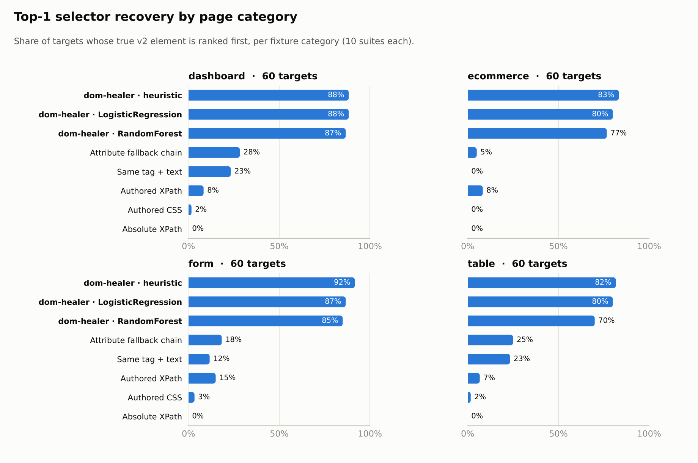

# dom-healer

**Self-healing CSS/XPath selectors for browser automation, without calling an LLM.**

When a UI redesign breaks `div.product-card:nth-child(2) button.btn-add-cart`, dom-healer
finds the same logical element in the new DOM and hands back a fresh, verified selector. It
works from a lightweight **structural fingerprint** of the element and a fast candidate ranker.
It is pure Python (lxml + cssselect + NumPy, with scikit-learn only for training), needs no
browser, and makes no network calls.

```text
$ dom-healer repair --old-html examples/shop_v1.html --new-html examples/shop_v2.html \
                    --selector "button[data-testid='add-SK-200']"
status:     healed  (confidence 0.758, margin 0.224, ranker heuristic)
target:     button 'add to cart' under 'summit kicks'
original:   button[data-testid='add-SK-200']  (0 match(es) in new page)
css:        [data-sku="SK-200"] button  [anchored:tag]
xpath:      //*[@data-sku='SK-200']//button[normalize-space()='Add to bag']
candidates:
  1. 0.758  button 'add to bag' under 'summit kicks'
  2. 0.534  button 'add to bag' under 'mesa hiker'
  3. 0.531  button 'add to bag' under 'trail runner 2'
```

In that example, v2 renamed every class, removed the `data-testid`, changed the copy from "Add to
cart" to "Add to bag", reordered the cards, moved this one into a declarative shadow root and
added a hidden decoy button. The engine still picked the button of the *right product* (Summit
Kicks) over two identical-looking buttons.

## Results at a glance

On 40 adversarially mutated page pairs (240 target elements; the [benchmark](#benchmark) section explains the method):

<picture>
  <source media="(prefers-color-scheme: dark)" srcset="docs/assets/recovery_accuracy_dark.png">
  
</picture>

| Method | Top-1 | Top-3 | Median latency |
|---|---:|---:|---:|
| **dom-healer, heuristic ranker (default)** | **86.2%** (95% CI 81–90) | **92.5%** | 4.75 ms cold · 1.25 ms warm |
| dom-healer, LogisticRegression (5-fold CV) | 83.8% (79–88) | 92.5% | 4.84 ms cold · 1.23 ms warm |
| dom-healer, RandomForest (5-fold CV) | 79.6% (74–84) | 92.9% | 14.80 ms cold |
| Attribute fallback chain (id → test-id → name → aria-label → … → text) | 19.2% | 29.6% | 0.14 ms |
| Same tag + same text | 14.6% | 24.2% | 0.04 ms |
| Authored XPath | 9.6% | 12.5% | 0.03 ms |
| Authored CSS | 1.7% | 1.7% | 0.11 ms |
| DevTools-style absolute XPath | 0.0% | 0.0% | 0.004 ms |

**Read these numbers critically:**

* **The ML rankers did not beat the hand-weighted heuristic.** LogisticRegression is 2.4 points
  lower, but that gap is not statistically significant (exact McNemar test, p = 0.26). RandomForest is
  significantly worse (p = 0.007) and about 3× slower. With ~3.5k candidate rows from 240 queries,
  the hand-tuned priors hold up as well as the learned models. The default ranker is therefore the heuristic. The
  LogisticRegression model is bundled as `ranker="linear"`.
* **"< 5 ms" depends on what you count.** When the page index is reused for several selectors
  on the same page (*warm*), healing takes a median of **1.25 ms**, a p95 of **2.56 ms**, and 99.6% of heals finish
  under 5 ms. The *cold* worst case builds a fresh index and clears all caches for every single selector.
  It has a median of **4.75 ms**, a **p95 of 8.4 ms**, and only 55% finish under 5 ms. Parsing the HTML adds a
  median of 0.76 ms. Measured on a 4-vCPU Intel Xeon @ 2.10 GHz cloud VM with Python 3.13.
* The baselines score low largely *by construction*: the v2 pages were written to break selectors.
  The useful comparison is against the fallback chain, which is what many "smart locator"
  setups do today.
* **The engine was developed against suites 01–03 only.** Suites 04–10 of every category were
  never inspected. The heuristic scores **84.7%** on the dev suites (n = 72) and **86.9%** on the held-out suites
  (n = 168), so there is no sign of overfitting the dev set.

## Install

```bash
pip install -e .            # core: lxml, cssselect, numpy
pip install -e ".[ml]"      # + scikit-learn, to train your own ranker
pip install -e ".[mcp]"     # + MCP server
pip install -e ".[dev]"     # everything, including tests and benchmark plotting
```

Python 3.10–3.13.

## Usage

### Python API

```python
from dom_healer import heal, capture_fingerprint, locate, Healer

# 1. You still have the old page: repair directly.
result = heal(old_html, new_html, "div.product-card:nth-child(2) .add-to-cart")
result.status       # "valid" | "healed" | "low_confidence" | "not_found"
result.selector     # verified-unique CSS selector in the new page
result.xpath        # verified-unique XPath
result.element      # the lxml element
result.confidence   # score of the best candidate (0..1)
result.candidates   # ranked alternatives (each with .css / .xpath / .score)

# 2. The usual production flow: fingerprint while the selector works, heal later.
fp = capture_fingerprint(page_html_today, "#checkout")
stored = fp.to_json()                       # keep next to your test / page object
result = locate(stored, page_html_next_month)

# 3. Several broken selectors on one page: build the index once (the warm path).
healer = Healer(new_html)
for fp in fingerprints:
    print(healer.locate(fp).selector)
```

Inputs can be HTML `str`/`bytes`, a `dom_healer.Document`, an lxml element or tree, or a
BeautifulSoup object.

### CLI

```bash
dom-healer repair --old-html v1.html --new-html v2.html --selector "#email" [--json] [--top-k 3]
dom-healer fingerprint --html v1.html --selector "#email" -o email.fp.json
dom-healer locate --fingerprint email.fp.json --html v2.html
dom-healer mcp                       # MCP server on stdio
```

Exit codes: `0` means the element was found confidently (`valid`/`healed`), `1` means `low_confidence`
or `not_found`, and `2` means bad input (unreadable file, invalid selector, or a selector that matches nothing
in the old page). `--ranker heuristic|linear|path/to/model.json` and `--min-confidence`
change the defaults.

### MCP server

`dom-healer mcp` exposes three tools to MCP clients (AI agents, IDEs): `repair_selector`,
`capture_fingerprint` and `locate_element`. For example, in a client config:

```json
{ "mcpServers": { "dom-healer": { "command": "dom-healer", "args": ["mcp"] } } }
```

## How it works



**The fingerprint** (`dom_healer.fingerprint.ElementFingerprint`) records signals that tend to
survive redesigns, and none of it depends on the selector that found the element:

| Group | Signals |
|---|---|
| Identity | tag, ARIA role (explicit or implicit), functional family (clickable, choice, text input, cell, …), id, classes, stable attributes (`data-*`, `aria-*`, `name`, `type`, `placeholder`, `href` path, …) |
| Text | own text, full text, accessible name (aria-label → aria-labelledby → `<label>` → placeholder/alt/title/text) |
| Context | associated label, nearest in-scope heading, preceding and following text, text of the containing card or line item, table row text and column header (also for `role="grid"` div tables), enclosing form, landmark |
| Structure | tag path, *semantic* path (structural roles only, so wrapper divs do not matter), depth, wrapper-insensitive sibling neighbourhood, child tags, document position |
| State | static visibility (hidden, aria-hidden, inline display:none, closed `<dialog>`), shadow-DOM depth |

**Pairwise features** compare a stored fingerprint with each candidate: text similarity
(character-trigram Dice and canonical-word Jaccard with light stemming, unit splitting such as
"30D" → "30 day", and a small UI-synonym table such as cart/bag and sign in/log in), Jaccard over
attributes, classes and ancestor tokens, LCS over tag paths, sibling and position similarity, and penalties for hidden or shadow-DOM mismatches.
A feature is `NaN` when the original element had no such signal, and the heuristic averages only the
applicable features. Query-relative columns (`x − max(x)` over the candidate pool) let pointwise
models reason about "best on this page".

**Selector synthesis** walks from the most to the least robust strategy and checks each
attempt against the page index rather than re-running a selector engine. The returned
CSS and XPath are re-checked with cssselect and libxml2. On the benchmark, every healed selector (238/238 CSS,
238/238 XPath) resolves to exactly the predicted element.

**Shadow DOM.** `<template shadowrootmode>` content is flattened into its host, which mirrors
Playwright's shadow-piercing CSS. Emitted CSS works with Playwright. Selenium cannot evaluate
XPath inside shadow roots, so the XPath for such elements only applies to the composed tree.

## Benchmark



**Fixtures** (`benchmarks/fixtures/`, specified in [`benchmarks/fixtures/README.md`](benchmarks/fixtures/README.md)).
There are 10 e-commerce, 10 dashboard, 10 table and 10 form pages, each with a "v2" redesign. Every v2
obfuscates classes (CSS-modules, styled-components, emotion and Tailwind styles), adds wrapper divs,
reorders siblings, adds at least one declarative shadow root, and includes decoys (same-text buttons
in other cards or rows, hidden duplicates, mobile-menu copies, repeated "recommended" items). Most
pages also regenerate ids, rename or drop `data-testid`, change copy and change tags (`a` → `button`,
`table` → `div[role=grid]`). Each page has 5–6 targets, 240 in total, and 65 of them sit inside a shadow root in
v2. The v2 pages average 479 elements (max 793). The ground truth is a `data-dh-target` attribute that is
**deleted before any method sees the DOM**. `benchmarks/validate_fixtures.py` checks that every authored
selector matches exactly its target in v1 and that every required mutation is present.

**Protocol.** The learned rankers are trained on the same candidate pools and features used at
inference, with 5-fold cross-validation **grouped by suite**, so no page is ever in both the training and
test folds. Leave-one-category-out is also reported. Latency is the median of 5 runs per target;
"cold" rebuilds the page index and clears every memo cache on each run.

<picture>
  <source media="(prefers-color-scheme: dark)" srcset="docs/assets/latency_dark.png">
  
</picture>

<picture>
  <source media="(prefers-color-scheme: dark)" srcset="docs/assets/recovery_by_category_dark.png">
  
</picture>

### Top-1 by category

| Method | dashboard | ecommerce | form | table |
|---|---:|---:|---:|---:|
| dom-healer · heuristic | 88.3% | 83.3% | 91.7% | 81.7% |
| dom-healer · LogisticRegression | 88.3% | 80.0% | 86.7% | 80.0% |
| dom-healer · RandomForest | 86.7% | 76.7% | 85.0% | 70.0% |
| Attribute fallback chain | 28.3% | 5.0% | 18.3% | 25.0% |
| Same tag + text | 23.3% | 0.0% | 11.7% | 23.3% |
| Authored XPath | 8.3% | 8.3% | 15.0% | 6.7% |
| Authored CSS | 1.7% | 0.0% | 3.3% | 1.7% |

### Top-1 by mutation type (heuristic)

A target can carry several tags.

| Mutation | n | Attribute fallback | dom-healer heuristic |
|---|---:|---:|---:|
| class-obfuscation | 223 | 20.6% | 86.1% |
| decoy | 149 | 17.4% | 86.6% |
| sibling-reorder | 149 | 16.8% | 83.9% |
| attribute-churn | 136 | 17.6% | 90.4% |
| copy-change | 134 | 11.2% | 84.3% |
| wrapper-divs | 103 | 26.2% | 83.5% |
| id-change | 100 | 18.0% | 89.0% |
| structure-move | 73 | 20.5% | 86.3% |
| shadow-dom | 71 | 11.3% | 84.5% |
| tag-change | 62 | 3.2% | **75.8%** |
| insertion | 53 | 24.5% | 92.5% |
| testid-change | 17 | 5.9% | **70.6%** |

**Leave-one-category-out:** LogisticRegression 81.7% Top-1 / 92.5% Top-3, RandomForest 75.4% / 91.2%.
Tables generalise worst (71.7% / 68.3% when no table pages are in training).

### Confidence and abstention

`status` is `healed` only when confidence ≥ `min_confidence` (default 0.5). For the heuristic
on all 240 targets:

| Threshold | Share flagged confident | Accuracy when confident | Accuracy when not |
|---:|---:|---:|---:|
| 0.4 | 85.4% | 90.7% | 60.0% |
| 0.5 (default) | 63.3% | 94.1% | 72.7% |
| 0.6 | 34.6% | 97.6% | 80.3% |

The default is conservative: many `low_confidence` results are still right, so read the candidates
before failing a test on them. The default was not tuned on this table; it was fixed beforehand.

### Reproduce

```bash
pip install -e ".[dev]"
python benchmarks/validate_fixtures.py          # format + ground-truth checks
python benchmarks/run_benchmark.py              # ~1–2 min; writes benchmarks/results/ and docs/assets/
python benchmarks/run_benchmark.py --export-model   # also retrains the bundled LR model on all 40 suites
```

`benchmarks/results/summary.md` holds every table above plus per-split, latency-breakdown and
feature-importance tables. `results.json` holds per-target ranks for every method.

## Limitations

* **Pool recall caps accuracy at 95%.** For 12 of the 240 targets, the true element never reaches the 24
  fully-scored candidates, so no ranker can recover it.
* **Tag changes and dropped test ids are the weak spots** (75.8% and 70.6% Top-1). A link that becomes a
  `role="tab"` button and loses its text is genuinely hard without seeing the rendered page.
* **There is no CSS engine.** Visibility is inferred from `hidden`, `aria-hidden`, inline styles and common
  utility classes only. An element moved into a closed overflow menu is penalised as "hidden".
* **Healed selectors are verified, but some are positional.** When v2 offers no stable attributes
  (obfuscated classes, no ids or test ids), the CSS falls back to `anchor > div:nth-of-type(2) > …`
  (89 of 238 benchmark heals). Those work now but are brittle against the next redesign. The XPath
  output usually anchors on visible text instead.
* **The benchmark was built by the same project that built the engine.** The fixtures were written by
  sub-agents that were told not to read the engine. The initial heuristic weights and synonym table were
  written before any fixture existed. Later changes (the container-text signal, stemming and unit
  splitting) came from inspecting failures on the dev suites (01–03) only. The held-out numbers are the
  honest estimate, and the suites are still small: ±5 points of CI.
* Timings are pure CPython on one VM. Expect them to vary by roughly 2× across machines.

## Development

```bash
pip install -e ".[dev]"
pytest --cov=dom_healer          # 166 tests, ~98% branch coverage
ruff check src tests
```

```text
src/dom_healer/
  dom.py           parsing, composed tree (shadow DOM), CSS/XPath evaluation
  fingerprint.py   ElementFingerprint + capture
  index.py         PageIndex: document order, attribute/text/heading indexes, candidate retrieval
  features.py      pairwise structural-diff features
  rankers.py       HeuristicRanker, LinearRanker (NumPy-only), SklearnRanker
  synthesis.py     verified selector generation
  healer.py        Healer, heal(), locate(), capture_fingerprint()
  ml.py            training utilities (scikit-learn)
  cli.py           dom-healer CLI          mcp_server.py   MCP tools
  data/linear_ranker.json   bundled LogisticRegression weights
benchmarks/        fixtures, validator, run_benchmark.py, plots.py, results/
tests/             pytest suite
```

## License

MIT © 2026 Anshumaan Das
